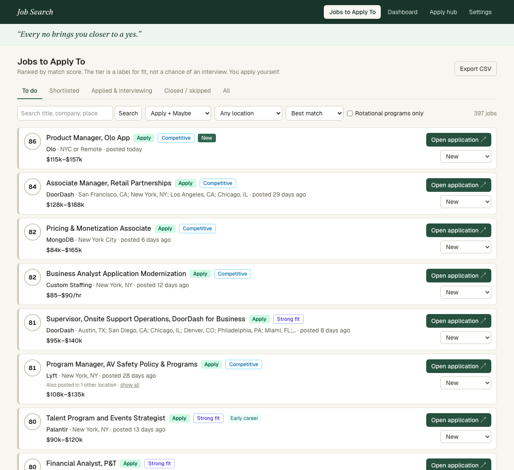
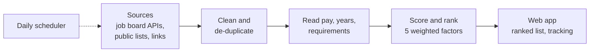
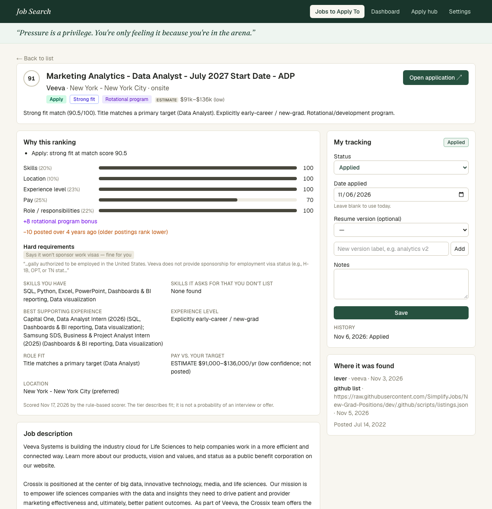

# Job Search Analytics Platform

Searching for a new grad job means checking dozens of job boards, scrolling past senior roles, and guessing which postings are still open. I built this app to do that part for me. Every day it pulls new postings from public job board APIs, cleans and de-duplicates them, and scores every one against my résumé and my preferences for pay, location and role. What comes out is one ranked list of jobs worth applying to. Each job has a plain-English reason for its rank and a link straight to the employer's application page. I still apply to every job myself. The app finds and ranks; it never fills out or submits an application.

## By the numbers

As of November 17, 2026:

| | |
|---|---|
| Job postings collected | 20,267 from 1,282 companies |
| Duplicate postings merged across sources | 826 |
| Stale listings closed automatically | 3,462 |
| Active postings scored | 16,805 |
| Ranked Apply or Maybe | 503 (the top 3%) |
| Refresh schedule | Daily, 9 scheduled updates since November 9, all successful |
| Automated tests | 280 |

## How it works

### 1. Sources

The app only collects jobs from places that allow it.

- **Greenhouse, Lever and Ashby:** the public job board APIs that companies use to post their openings.
- **Public GitHub job lists and Google Sheets:** new grad lists that people maintain and share.
- **Adzuna API:** a job search API with a hard cap on calls per day, as it's paid per call.
- **Pasted links and CSV files:** for LinkedIn, Indeed, Reddit and company career sites. The app never scrapes these. I paste the link or download the file myself.

I read each site's terms before adding it. If a site says no automated access, the app doesn't touch it. Every source has rate limiting and retries with backoff.

### 2. Cleaning and de-duplication

The same job often shows up in three or four places. The app normalizes the company, title and location into one key and also compares the application links, so each job appears once no matter where it was found. That has merged 826 duplicates so far.

Old postings are the other problem. Job lists keep jobs up long after they close. The app closes a job when its employer's board stops listing it, and closes list-only jobs after they've been missing for 3 days. It has closed 3,462 listings this way. If I'm tracking a job that closes, it stays visible with a "Listing closed" badge, so I don't lose it.

### 3. Reading each posting

Most of what matters is buried in the description text. The app reads it for:

- **Pay:** base pay, bonus and equity as separate fields. A bonus never counts toward my base pay minimum.
- **Years of experience and seniority:** so senior roles drop out.
- **Hard requirements:** security clearance, citizenship, sponsorship and certifications. These are flagged separately instead of being folded into the score.

When a posting doesn't list pay, the app estimates it from similar postings. Estimates are clearly labeled, show their confidence, and live in separate columns, so an estimate is never shown as real pay.

### 4. Scoring and ranking

Every active job gets a match score from 0 to 100 across 5 weighted factors: skills, experience level, role and responsibilities, pay, and location. I can change the weights in Settings and rescore everything in about a minute. Older postings rank lower: after 30 days a job starts losing points, up to 10 points at 6 months. Job lists keep old postings up for years, and I'd rather see what was posted this week first.

Each job also gets:

- **A tier:** Strong fit, Competitive or Reach. This is a label for fit. It is not a chance of getting an interview.
- **A recommendation:** Apply, Maybe or Skip, with the reasons.
- **The skills it asks for that I have, the ones I don't, and which of my experiences back it up best.**

I chose a rule-based scorer over a black box on purpose. If the app tells me to skip a job, I want to see why.

A job I applied to. The page shows the score breakdown, the experience from my résumé that backs it up best, a pay estimate that is clearly labeled, and my own tracking. It was found on two sources and merged into one listing.

### 5. The web app

- **Jobs to Apply To:** the ranked list, with filters and an "Open application" button.
- **Job detail:** the score breakdown, flags and the full description.
- **Tracking:** New, Shortlisted, Applied, Interviewing, Offer, Rejected or Skipped. Every change is logged with a date.
- **Dashboard:** what's new since the last update, my application pipeline, and which sources were checked.
- **Skip feedback:** when I skip a job, the app asks why. If I keep skipping for the same reason, it suggests a Settings change, like lowering the maximum years of experience. Nothing changes until I click Apply.
- **CSV export**, so I can open my list in Excel.

## Tech stack

| Layer | Tools |
|---|---|
| Data pipeline and API | Python, FastAPI, SQLAlchemy, Alembic |
| Database | PostgreSQL 16 |
| Web app | Next.js, React, TypeScript, Tailwind CSS |
| Scheduling | A small polling worker, with a database lock so updates never overlap |
| Infrastructure | Docker Compose |
| Testing | pytest (280 tests) |

## How I built it

I built this with Claude Code, an AI coding assistant, in November 2026. I acted as the product owner. I wrote the requirements and the rules the app has to follow (they're in [`CLAUDE.md`](CLAUDE.md)), decided what to build in each phase, and tested every feature against my own job search. Claude Code wrote most of the code. I tuned the scoring the same way an analyst would: look at a sample of ranked jobs, find the ones that were wrong, and change the rules.

I think the most useful thing I learned is that the data was the hard part, not the scoring. Before I could rank anything, I had to deal with duplicate postings, closed jobs that were still listed, and pay written ten different ways.

## Limitations

- **It runs on my laptop.** It needs a database and a scheduler, so there's no live demo. The screenshots above are from my own instance.
- **The scorer reads text with rules,** so an unusual posting can be misread.
- **A posting's date isn't always its real age.** Some employers reuse one posting every year, so a current role can look years old and rank a little lower than it should.

## What's next

- An AI scorer that runs next to the rule-based one. I'll measure how often each agrees with the jobs I actually chose to apply to or skip.

## Run it yourself

New here? Start with [`docs/SETUP.md`](docs/SETUP.md). Commands for running, testing and changing the app are in [`docs/DEVELOPMENT.md`](docs/DEVELOPMENT.md).

My résumé, profile and settings are not in this repository. You add your own.
